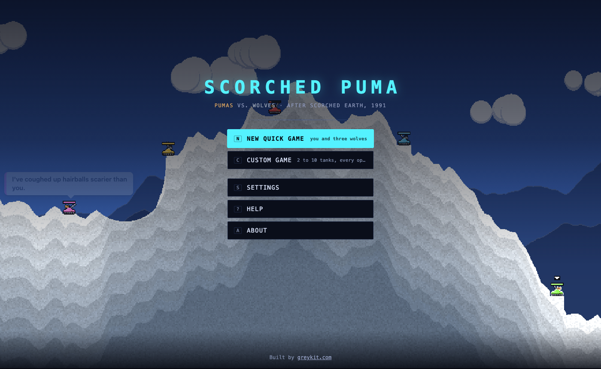
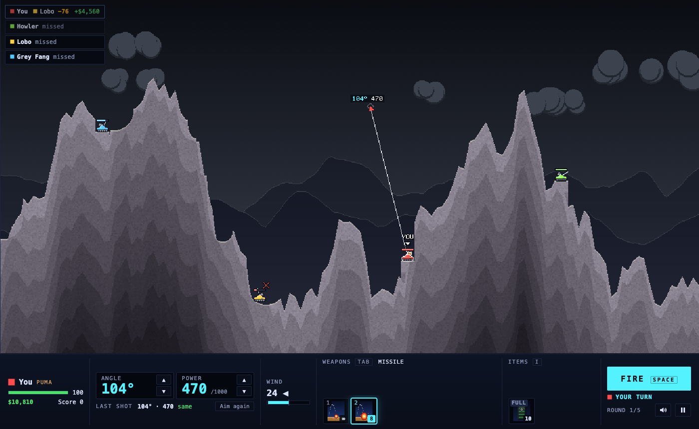

# Scorched Puma

**Artillery on a field of falling dirt, pumas against wolves.** A remake of *Scorched Earth* (Wendell Hicken, 1991, DOS; version 1.5, 1995), "the mother of all games", with every tank crewed by a puma or a wolf, and none of them polite about it.

**Play:** [greykit.com/games/scorchedpuma](https://greykit.com/games/scorchedpuma/)

## How it plays

Two to ten tanks, each human or computer, each a **Puma** or a **Wolf**, take turns: set the angle and the power, pick a weapon, fire. Wind pushes every shot, blasts dig craters, and the dirt falls. There are 33 weapons, from the Baby Missile to the Nuke, and 15 items, among them guidance, parachutes, shields and fuel. Eight computer players range from Moron to Cyborg, plus Unknown, which is one of the others and won't say which. Between rounds the shop, **Puma Arms** or **Wolf Surplus**, sells with what damage, kills and surviving have paid; the match goes to the best score.

The options are 1.5's: rounds, cash, interest, arms level, scoring, wind, gravity, walls, skies, land, falling dirt, and **Pumas vs. Wolves**, a team match. Not included: 1.5's *Simultaneous* real-time mode, network play and its choice of tank shapes.

## Keys

For keyboard and mouse in a window at least 640 × 300, or a phone held sideways. <kbd>←</kbd> <kbd>→</kbd> turn the turret, <kbd>↑</kbd> <kbd>↓</kbd> set the power, <kbd>Space</kbd> fires; or press on the field to aim there and drag to fine-tune. With a Fuel Tank, <kbd>F</kbd> drives. <kbd>?</kbd> lists every key; <kbd>M</kbd> is sound.

## Saves

Kept in the browser's `localStorage` under keys starting `scorchedpuma_`. **Settings → Forget everything** clears them.

## Credits

*Scorched Earth* was made by Wendell Hicken. Scorched Puma is not affiliated with Wendell Hicken and uses none of the original's code, art, sound or text.

Working on the game: [DEVELOPMENT.md](DEVELOPMENT.md).

By Matthew "Shan" Romanek, with Claude. Built by [greykit.com](https://greykit.com/).

Made for my own play. Nothing here is offered: no support, no updates, no licence.
