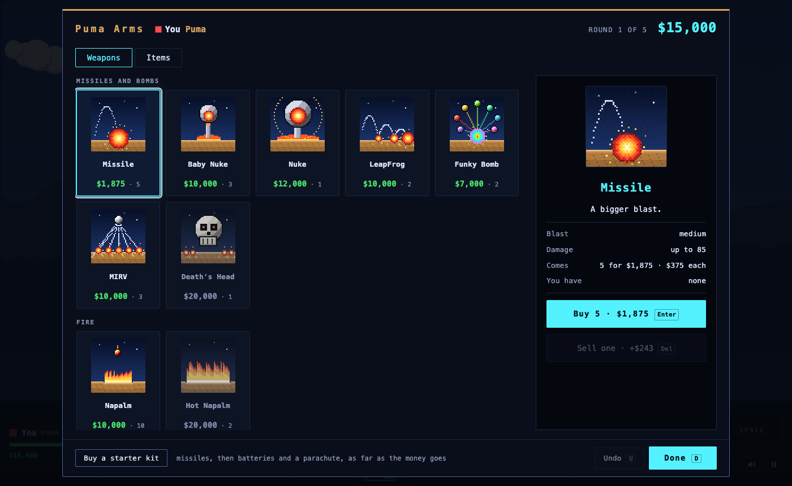

# Scorched Puma

**Artillery on a field of falling dirt, pumas against wolves.** A remake of *Scorched Earth* (Wendell Hicken, 1991, DOS; version 1.5, 1995), "the mother of all games", with every tank crewed by a puma or a wolf, and none of them polite about it.

Play it at [greykit.com/games/scorchedpuma](https://greykit.com/games/scorchedpuma/).




## What it is

A static site: one `index.html`, plain scripts and stylesheets, and a few icons. There is no build step, no server code and nothing fetched at play time; every picture is drawn and every sound made in the page.

The game is 1.5's:

- Two to ten tanks, each one human or computer, each a **Puma** or a **Wolf**. Take turns: set the angle and the power, pick a weapon, fire. Wind pushes every shot, blasts dig craters, and the dirt falls.
- **33 weapons**, from the Baby Missile to the Nuke, MIRV, Death's Head, Napalm, Rollers, Diggers, Sandhogs, the dirt weapons and the Laser; **15 items**, among them guidance, parachutes, batteries, shields and fuel.
- **8 computer players**: Moron, Shooter, Poolshark, Tosser, Chooser, Spoiler, Cyborg, and Unknown, which is one of the others and won't say which.
- A shop between rounds, **Puma Arms** or **Wolf Surplus**: damage, kills and surviving pay, and cash in hand earns interest. The match goes to the best score.
- 1.5's options: rounds, cash, interest, arms level, three scoring modes, turn order, wind, gravity, air, eight wall settings, six skies, three kinds of land, hanging dirt, fall damage, and **Pumas vs. Wolves**, a team match.
- The tanks talk, and Settings says how often.

Not in this version: 1.5's *Simultaneous* real-time mode, network play, and its choice of tank shapes.

It plays with a keyboard and a mouse: <kbd>←</kbd> <kbd>→</kbd> turn the turret, <kbd>↑</kbd> <kbd>↓</kbd> set the power, <kbd>Space</kbd> fires. Or press on the field to aim there and drag to fine-tune. To drive, buy a Fuel Tank, then hold ◀ ▶ by Drive under your tank, or press <kbd>F</kbd> and use <kbd>←</kbd> <kbd>→</kbd>. <kbd>?</kbd> in the game lists every key.

## Run it locally

Serve the folder with any static web server and open the address it prints. With Python:

```bash
python3 -m http.server 8000
```

Then open <http://localhost:8000/>. Serve it rather than opening `index.html` from disk: browsers restrict pages loaded from `file://`.

## Deploy it

Copy the files to any static host. Every URL in the page is relative, so it works at the site root or under any path.

Leave these out; they are for working on the game, not playing it:

| | |
|---|---|
| `.git/`, `.gitlab-ci.yml` | the repository and its pipeline |
| `tools/` | development scripts |
| `screenshots/` | the pictures in this README |

`README.md`, `DEVELOPMENT.md` and `LICENSE` can go or stay. With rsync:

```bash
rsync -av --delete --exclude='.git' --exclude='.gitlab-ci.yml' --exclude='tools' --exclude='screenshots' ./ user@host:/path/to/scorchedpuma/
```

Every script and stylesheet URL carries a hash of its contents, so a long cache lifetime on the host is safe: a changed file has a new URL.

The share-card tags in `index.html` (`og:url`, `og:image`, `twitter:image`) name the greykit.com address. The game does not need them; change them if link previews should point at your copy.

## Browser and screen

Scorched Puma is built for a desktop: a current browser, a keyboard and a mouse. A window narrower than 760 pixels or shorter than 480 shows a note saying so instead of the game. The field is as wide as the window when a match begins, between 960 and 1440 pixels of field, scaled to fit.

Sound uses Web Audio and starts on the first key or click, as browsers require. <kbd>M</kbd> turns it off.

## What it stores

Only `localStorage`, in four keys:

| Key | What |
|---|---|
| `scorchedpuma_match_v1` | the match in progress, saved at the start of every turn |
| `scorchedpuma_setup_v1` | the last custom game |
| `scorchedpuma_prefs_v1` | the settings |
| `scorchedpuma_muted_v1` | sound on or off |

No cookies, and nothing is sent anywhere. To clear it, open **Settings** and press **Forget everything**: it removes every key that starts with `scorchedpuma`, and only those, then reloads. Clearing the site's data in the browser works too, but it also clears anything else stored by that site.

## License

[MIT](LICENSE).

Game design and code by [shandower](https://gitlab.com/shandower) with AI assistance from Claude.

After Scorched Earth by Wendell Hicken. Not affiliated with Wendell Hicken; no code, art, sound or text from the original is used.

Working on the game itself: [DEVELOPMENT.md](DEVELOPMENT.md).
